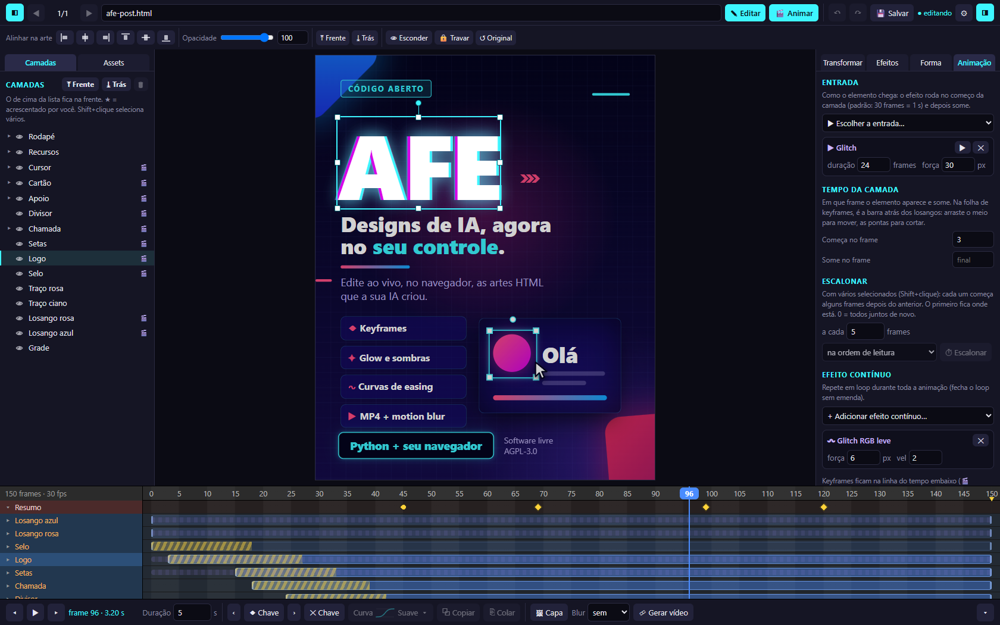
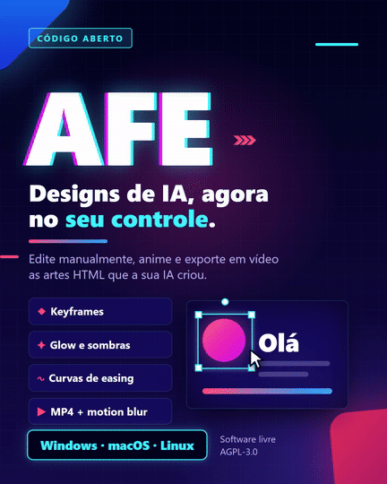
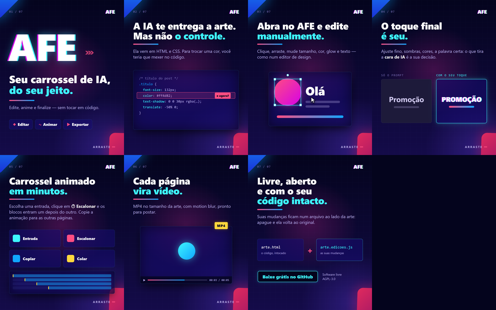

# AFE <sup>beta</sup>

[Português (BR)](README.md) · **English**

> **A note first:** I'm not a programmer. I'm a designer, and I built AFE with the help of AI to solve my own
> problem — editing the HTML artwork AI generates without having to touch the code. I'm opening the project so
> the community can use it, test it, fix it and help it grow. Contributions of every kind are welcome (see
> [CONTRIBUTING.md](CONTRIBUTING.md)).
>
> **Beta:** it works and has an automated test, but there may still be rough edges. If something breaks, please
> open an *issue*.

### ⬇ [Download AFE for free](https://github.com/adrianofernandesvideo/afe/releases) — Windows, macOS and Linux

Or try it now in your browser, nothing to install: **[open the live preview](https://adrianofernandesvideo.github.io/afe/)**

A visual editor for artwork made in HTML — social posts, carousels, stories, banners. You open the art in the
browser and adjust it **manually**, without touching its code: move, resize and retype, glows and
shadows, corners and outlines, add images and shapes, animate with keyframes and render the video.



<p align="center"><br><sub>The artwork above, animated in AFE and exported to video (with motion blur).</sub></p>

> **Heads-up:** the editor's interface is currently in **Portuguese** only (the docs explain each button). All the
> documentation is available in English in [docs/en/](docs/en/); a multi-language interface is on the roadmap.

## What it does

- **Edits any fixed-size `.html` artwork** — including art built by a script.
- **Never rewrites your art:** changes are stored as data in a file next to it (`<art>.edicoes.js`). Delete
  that file and the art is back to the original.
- **Effects:** layered glows and shadows, color, image adjustments, corners, fills and gradient outlines,
  **blend modes** (Multiply, Screen, Overlay…) and animated **film grain**.
- **Images from your computer:** drag and drop onto the artwork (becomes a layer) or into the Assets tab.
- **Assets:** shapes, text, images, external asset libraries (your brand's, for example) and **code
  components** from a design system.
- **Animation:** keyframes with easing curves, a keyframe sheet, per-layer timing, ready-made entrances,
  looping continuous effects, a cover frame.
- **Video:** renders the page to MP4, with optional motion blur.
- **Configurable shortcuts**, undo/redo, and a backup of the previous version on every save.

## Requirements

- **With the executable (Releases):** just a browser (Edge or Chrome). No Python needed.
- **From the source code:** Python 3 (the server uses only the standard library) and Edge or Chrome.
- **To render video and run the automated test:** also [Playwright for Python](https://playwright.dev/python/)
  and [ffmpeg](https://ffmpeg.org) on the PATH.

The editor never installs anything by itself: if something is missing, it tells you what.

> Developed and used on **Windows** with Python 3.14. macOS, Linux and older Python versions have not been
> tested yet — reports and fixes are welcome.

## Download and use

- **Download:** on the [Releases](https://github.com/adrianofernandesvideo/afe/releases) page, get the `.zip` for your system (Windows, macOS or Linux), unzip it
  and double-click **AFE**. No Python needed. To use it with your own artwork, drag its `.html` onto AFE.
- **Want to see it before installing?** The **[live preview](https://adrianofernandesvideo.github.io/afe/)** is the real editor, in the browser, with the
  demo artwork. Your edits stay in your browser only (you can download them). Video rendering and asset libraries
  only work in the downloaded AFE.

Every push to `main` automatically creates a new release (`2.3.0-beta`, `2.3.1-beta`…) and updates the online
demo — see [distribuir/LEIA.md](distribuir/LEIA.md).

## Try it in 2 minutes (with Python)

From inside the AFE folder:

```bash
python servidor.py --raiz demos/artes
```

Open `http://localhost:8765/editor/?arquivo=afe-post.html`, click **✎ Editar** (Edit) and play around:
it's the demo artwork from the picture above (turn on **🎬 Animar** to see the animation). Nothing you do
changes its code — only the edits file next to it.

The same folder has a **7-page carousel** about AFE — each page shows the feature it describes. See
[demos/LEIA.md](demos/LEIA.md) (texts in Portuguese).



## Use it with your own art

The commands run from inside the AFE folder; your artworks can live anywhere.

```bash
python ligar.py ../my-art/art.html               # once per artwork ("ligar" = connect)
python servidor.py --raiz ../my-art               # opens the editor ("raiz" = root folder)
```

With an asset library (shown in the Assets tab for every artwork):

```bash
python servidor.py --raiz ../my-art --biblioteca Brand=../my-brand/assets
```

The full step by step, including what an artwork needs, is in [docs/en/SETUP.md](docs/en/SETUP.md).

## Documentation

| I want to… | Read |
|---|---|
| install, connect an artwork, open the editor | [docs/en/SETUP.md](docs/en/SETUP.md) |
| use the editor | [docs/en/MANUAL.md](docs/en/MANUAL.md) |
| see what exists and the ideas for later | [docs/en/ROADMAP.md](docs/en/ROADMAP.md) |
| change the code | [docs/en/ARCHITECTURE.md](docs/en/ARCHITECTURE.md) and [CONTRIBUTING.md](CONTRIBUTING.md) |
| understand why something is done in an odd way | [docs/en/DISCOVERIES.md](docs/en/DISCOVERIES.md) |
| see what changed in each version | [docs/en/CHANGELOG.md](docs/en/CHANGELOG.md) |

The same documents in Portuguese are in [docs/](docs/) (and [LEIA.md](LEIA.md) for setup).

## Security

The server only answers this computer (`127.0.0.1`) and checks where each request comes from. It only writes
each artwork's edits file and copies of library images/CSS inside the artwork's folder. The only program it
runs is the `render_anim.py` in this folder.

## Contributing

Ideas, fixes and usage reports are welcome. See [CONTRIBUTING.md](CONTRIBUTING.md).

## License

Copyright (C) 2026 Adriano Fernandes

This program is free software, released under the **[GNU Affero General Public License v3](LICENSE)**
(AGPL-3.0). In short: you may use, study, modify and even sell it — but anyone who distributes a modified
version, or lets other people use the editor over a network, must release that version's source code under
the same license. The [LICENSE](LICENSE) file is the text that applies.
