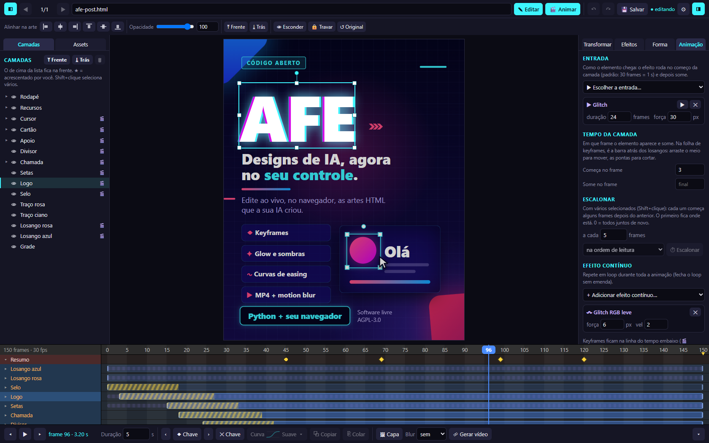
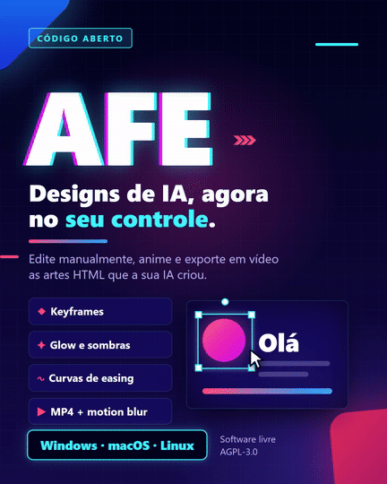
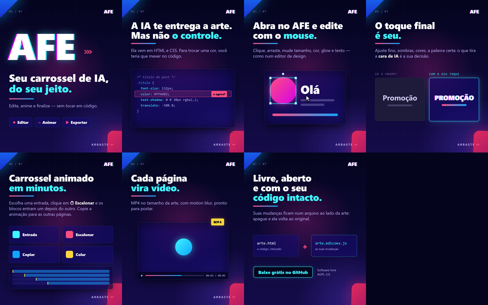

# AFE <sup>beta</sup>

**Português (BR)** · [English](README.en.md)

> **Um recado antes de tudo:** eu não sou programador. Sou designer e criei o AFE com a ajuda de IA para resolver
> um problema meu — editar as artes HTML que a IA gera sem precisar mexer no código. Estou abrindo o projeto para
> que a comunidade use, teste, corrija e faça ele crescer. Contribuições de todo tipo são bem-vindas
> (veja [CONTRIBUINDO.md](CONTRIBUINDO.md)).
>
> **Beta:** funciona e tem teste automático, mas ainda pode ter arestas. Se algo quebrar, abra uma *issue*.

Editor visual para artes feitas em HTML — posts, carrosséis, stories, banners. Você abre a arte no
navegador e ajusta **com o mouse**, sem mexer no código: mover, mudar tamanho e texto, glows e sombras,
cantos e contornos, acrescentar imagens e formas, animar com keyframes e gerar o vídeo.



<p align="center"><br><sub>A arte acima, animada no AFE e exportada em vídeo (com motion blur).</sub></p>

## O que ele faz

- **Edita qualquer arte `.html` de tamanho fixo** — inclusive artes montadas por script.
- **Não reescreve a arte:** as mudanças ficam num arquivo de dados ao lado dela (`<arte>.edicoes.js`). Apagar
  esse arquivo devolve a arte ao original.
- **Efeitos:** glow e sombras em camadas, cor, ajustes de imagem, cantos, preenchimento e contorno em
  gradiente.
- **Assets:** formas, texto, imagens, bibliotecas de assets de fora (os da sua marca, por exemplo) e
  **peças em código** de um design system.
- **Animação:** keyframes com curvas (easing), folha de keyframes, tempo de cada camada, entradas prontas,
  efeitos contínuos em loop, frame da capa.
- **Vídeo:** gera o MP4 da página, com motion blur opcional.
- **Atalhos configuráveis**, desfazer/refazer, cópia da versão anterior a cada salvar.

## Requisitos

- **Para editar:** Python 3 (o servidor usa só a biblioteca padrão) e um navegador Edge ou Chrome.
- **Para gerar vídeo e rodar o teste automático:** também o [Playwright para Python](https://playwright.dev/python/)
  e o [ffmpeg](https://ffmpeg.org) no PATH.

O editor não instala nada sozinho: se faltar algo, ele avisa o quê.

> Desenvolvido e usado no **Windows** com Python 3.14. macOS, Linux e versões mais antigas do Python ainda não
> foram testados — relatos e correções são bem-vindos.

## Começar em 2 minutos

Dentro da pasta do AFE:

```bash
python servidor.py --raiz demos/artes
```

Abra `http://localhost:8765/editor/?arquivo=afe-post.html`, clique em **✎ Editar** e mexa à
vontade: é a arte de demonstração da imagem acima (ligue o **🎬 Animar** para ver a animação). Nada
do que você fizer muda o código dela — só o arquivo de edições ao lado.

Na mesma pasta há um **carrossel de 7 páginas** sobre o AFE — cada página mostra a função que descreve. Veja
[demos/LEIA.md](demos/LEIA.md).



## Usar com as suas artes

Os comandos rodam de dentro da pasta do AFE; as artes podem ficar em qualquer lugar.

```bash
python ligar.py ../minhas-artes/arte.html        # uma vez por arte
python servidor.py --raiz ../minhas-artes        # abre o editor
```

Com uma biblioteca de assets (aparece na aba Assets de todas as artes):

```bash
python servidor.py --raiz ../minhas-artes --biblioteca Marca=../minha-marca/assets
```

O passo a passo completo, com o que a arte precisa ter, está no [LEIA.md](LEIA.md).

## Documentação

| Quero… | Leia |
|---|---|
| instalar, ligar uma arte, abrir o editor | [LEIA.md](LEIA.md) |
| usar o editor | [docs/MANUAL.md](docs/MANUAL.md) |
| saber o que existe e as ideias para depois | [docs/ROTEIRO.md](docs/ROTEIRO.md) |
| mexer no código | [docs/ARQUITETURA.md](docs/ARQUITETURA.md) e [CONTRIBUINDO.md](CONTRIBUINDO.md) |
| entender por que algo é feito de um jeito estranho | [docs/DESCOBERTAS.md](docs/DESCOBERTAS.md) |
| ver o que mudou em cada versão | [docs/CHANGELOG.md](docs/CHANGELOG.md) |

## Segurança

O servidor só atende este computador (`127.0.0.1`) e confere de onde vem cada pedido. Ele só grava o arquivo
de edições de cada arte e cópias de imagens/CSS das bibliotecas dentro da pasta da arte. O único programa que
ele roda é o `render_anim.py` desta pasta.

## Contribuir

Ideias, correções e relatos de uso são bem-vindos. Veja [CONTRIBUINDO.md](CONTRIBUINDO.md).

## Licença

Copyright (C) 2026 Adriano Fernandes

Este programa é software livre, sob a **[GNU Affero General Public License v3](LICENSE)** (AGPL-3.0).
Em resumo: você pode usar, estudar, modificar e até vender — mas quem distribuir uma versão modificada, ou
oferecer o editor para outras pessoas usarem pela internet, precisa liberar o código dessa versão sob a
mesma licença. O texto que vale é o do arquivo [LICENSE](LICENSE).

## Idiomas

Toda a documentação existe em português e em inglês (a versão em inglês fica em [docs/en/](docs/en/)). A tela
do editor ainda está só em português; deixar o editor multi-idioma está nas ideias do
[ROTEIRO](docs/ROTEIRO.md).
